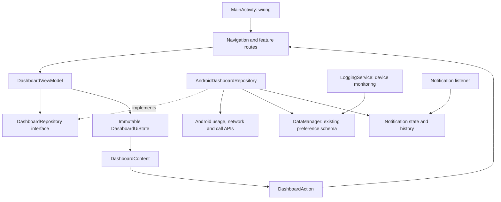

# UI independent from device tracking

## Tracewise namespace and installed compatibility

The visible app name is Tracewise and the Gradle namespace is
`com.sanjay.tracewise`, including Sanjay's name. Modern `data`, `ui`, and `core`
packages and tests use that prefix. Existing root-level legacy adapters remain
under `com.Sanjay.firstlogapp`; this is a deliberate compatibility boundary, not
a second app or monitoring implementation.

The installed application ID, preference/backup keys, FileProvider authority,
activity, services, and receiver class names remain unchanged. Manifest entries
now use fully qualified legacy component names so changing the namespace does
not change notification-listener identity, alarms, boot receivers, or launch
targets. Generated `R` imports use the new namespace. The instrumentation
`InstalledIdentityTest` verifies the installed ID and registered components on a
device; it is not a substitute for testing an actual update over an older APK.

The architecture guard scans both the new feature packages and retained legacy
adapters. `FirstLogAppTheme` and storage identifiers are intentionally preserved.

The app remains a single Android module. Package boundaries make UI changes possible without editing the logging service; Gradle modules can follow if enforcement or build times justify them.

## Actual boundaries in this change

- `MainActivity` now starts the existing service and wires dependencies. The old activity's duplicated network/radio receivers and telemetry writes are removed.
- `data/device` owns device and provider helpers, `data/local` owns the existing persistence adapter, and `data/model` holds activity records. These packages do not depend on Compose.
- `AndroidDashboardRepository` reads raw snapshots off the UI thread. `DashboardViewModel` owns refresh/error state and maps measurements to presentation state. `DashboardContent` sees neither the repository nor a context.
- The repository is injected through a ViewModel factory. No DI framework is needed for this size of app.
- `AnalyticsScreen` reads typed timestamped `AnalyticsSeries` through a repository on IO; a mapper formats chart points. `AnalyticsContent` renders a compact full-range chart. Query identity is metric + period, so selection changes cancel previous reads. Hourly queries do not invoke the old reconciliation that assigns unallocated duration to the current hour.
- `SettingsScreen` owns Android account/document/settings launchers and dispatches file work to IO. `SettingsContent` renders state and emits actions. A dedicated settings repository and ViewModel are the next boundary improvement; settings state currently lives in this adapter.
- `AppUsageContent` uses the same supplied app rows as the dashboard; it performs no second platform query.
- Shared formatting lives in `core`, theme and reusable Material controls in `ui/theme` and `ui/components`, and screens are grouped by feature.

## Intentional compatibility adapters

The preference key names, installed application ID, and Android service names remain unchanged. Metric quick views use native Material sheets, and extended histories now have a full-screen destination with typed repository results, IO reads, and rendering-only Content. Battery samples use a recent line plot, unlock sessions use a labelled retained-sample histogram, and radio history shares the compact chart. Notification details/replies and summary/report exports remain legacy adapters with platform access; those still need migration.

This is a package and presentation boundary refactor, not a Room/DataStore migration. `DataManager` getters can still trigger rollover, and separate instances still synchronize inadequately. Removing activity sensor callbacks reduces duplicate writers but does not make the underlying storage transactional.

## Next storage changes

1. Introduce one process-level transaction owner for session changes and rollover. Inject time and timezone rules and test the current preference behavior first.
2. Store sessions/history in Room with explicit schema versions, indexes, and transactions. Keep live counters as a cache, not the sole event history.
3. Move small settings to DataStore. Migrate legacy values once; never silently reset installed users.
4. Emit repository flows from storage. Remove periodic dashboard rereads and filter call-provider queries to the requested cycle.
5. Move notification state models out of the Android service, then migrate notification/summary/history routes independently.
6. Address recent Android foreground-service limits separately, with physical-device verification and a documented product decision about achievable monitoring.

## Checkable invariants

`python3 scripts/check_architecture.py` prevents data/services from importing Compose or UI, prohibits platform work in Content files, and prevents device monitoring from returning to the activity. This is a narrow dependency guard, not a substitute for compilation, lint, or runtime testing.

## Conversational analytics direction

The intended agentic chat will query SQLite through a bounded read-only analytics service, sharing metric definitions and repositories with charts. See [the database and agent architecture](AGENT_ANALYTICS_ARCHITECTURE.md) for proposed facts, coverage, migration sequencing, and query boundaries. SQLite/Room and the chatbot are not implemented by this UI change.
